<p align="center">
  
</p>

<p align="center">
  <a href="https://www.anypayx.com"></a>
  <a href="https://www.npmjs.com/package/anypay-plugin-polygon"></a>
  <a href="https://github.com/anypay/anypay-plugin-polygon/blob/main/LICENSE"></a>
  <a href="https://github.com/anypay/anypay-plugin-polygon"></a>
</p>

<p align="center">
  <a href="https://www.anypayx.com">Website</a> ·
  <a href="https://www.anypayx.com/docs">Docs</a> ·
  <a href="https://api.anypayx.com/api">API</a> ·
  <a href="https://www.anypayx.com/walletbot">WalletBot</a> ·
  <a href="https://github.com/anypay">GitHub</a> ·
  <a href="https://www.npmjs.com/package/anypay-plugin-polygon">npm</a>
</p>

---

## What It Is &amp; Purpose

**Anypay Polygon Plugin** is a blockchain integration module that enables USDC and MATIC payment processing on the Polygon network for Anypay's payment platform. This plugin implements the core payment workflow functions required to accept, validate, decode, and confirm ERC-20 token transfers on Polygon.

The plugin was developed in response to demand from wallet developers in the Anypay ecosystem for robust Polygon support, specifically for USDC stablecoin payments. It ensures that all USDC and MATIC payments on Polygon are valid, properly formatted, and confirm as expected every time.

Built with TypeScript and ethers.js, the plugin provides RPC communication with Polygon nodes, transaction decoding using ABI specifications, and seamless integration with Anypay's existing payment request and settlement infrastructure.

## Why Use It

**Anypay Polygon Plugin** brings enterprise-grade Polygon payment processing to the Anypay platform, eliminating the complexity of ERC-20 token handling and blockchain interaction for developers and merchants.

- **Who it's for:** Merchants, wallet developers, and payment integrators who want to accept USDC and MATIC on Polygon through Anypay's payment platform. This plugin is essential for anyone building on Anypay who needs Polygon support.

- **Where it fits:** This is a **core blockchain plugin** in the Anypay stack, sitting between the Anypay payment platform (`@anypay/server`) and the Polygon blockchain. It handles payment request construction, transaction validation, decoding, and broadcasting — all critical steps in the payment lifecycle that ensure funds move correctly and confirmably.

**Key benefits:**
- ✓ Supports USDC (ERC-20) and MATIC native token payments
- ✓ Automatic transaction decoding and validation against payment requests
- ✓ Infura RPC integration with retry logic and error handling
- ✓ Compatible with WalletBot for self-custody payment signing
- ✓ Built on battle-tested libraries: ethers.js, @maticnetwork/maticjs, abi-decoder

## How It Works

<p align="center">
  
</p>

The Polygon plugin implements a four-stage payment lifecycle:

1. **Anypay Core** receives a payment request from a merchant or application specifying USDC or MATIC on Polygon, including recipient address and amount in USD or crypto.

2. **Polygon Plugin** constructs a valid ERC-20 transfer transaction (for USDC) or native transfer (for MATIC) from the payment request. It generates proper contract calls, formats amounts in token decimals (6 decimals for USDC, 18 for MATIC), and returns a JSON payment request ready for wallet signing.

3. **Polygon RPC** (via Infura) receives the signed transaction from the wallet. The plugin broadcasts the signed transaction hex using `eth_sendRawTransaction` and monitors confirmation status. When a transaction ID is returned, the plugin decodes the transaction data using the ERC-20 ABI to extract recipient, amount, and token contract — validating it against the original request.

4. **Settlement** is confirmed once the transaction is included in a block. The plugin provides the validated transaction details back to Anypay Core, which updates the invoice status, triggers webhooks, and settles the payment.

Throughout this flow, the plugin handles Infura API communication (via `src/infura.ts`), transaction decoding with abi-decoder, and amount validation accounting for USDC's 6-decimal precision and MATIC's 18-decimal precision.

## Quickstart / How to Use It

> **Note:** This is an early-stage plugin. The examples demonstrate the intended usage patterns, but the full workflow requires integration with the Anypay platform and WalletBot for transaction signing.

### Installation

```bash
npm install anypay-plugin-polygon
```

### Environment Setup

Create a `.env` file with your Infura or Polygon RPC endpoint:

```env
ROOT_RPC=https://polygon-mainnet.infura.io/v3/YOUR_PROJECT_ID
```

### Create a Payment Request

```typescript
import anypay from 'anypay'

const paymentRequest = await anypay.request([{
  currency: 'USDC',
  to: [{
    address: '0xA77547a3fB82a5Fa4DB408144870B69c70906989',
    amount: 0.052,
    currency: 'USD'
  }]
}], {
  webhook_url: 'https://example.com/webhooks'
})

console.log('PaymentRequestCreated', paymentRequest)
```

### Decode and Validate a USDC Transaction

```typescript
import { parseUSDCTransfer } from 'anypay-plugin-polygon/examples/decode_transaction'

const txid = '0x85672c47a51c8771d6581be67cdee4f096724a252612bbb7b1cba4eeb65674e2'

const result = await parseUSDCTransfer(txid)
// Returns:
// {
//   to: '0x...',
//   amount: 52000, // in USDC base units (6 decimals)
//   currency: 'USDC',
//   chain: 'Polygon',
//   txid: '0x...'
// }
```

### Call Polygon RPC Directly

```typescript
import { callRPC } from 'anypay-plugin-polygon/src/infura'

const blockNumber = await callRPC('eth_blockNumber', [])
console.log('Current block:', parseInt(blockNumber, 16))

const tx = await callRPC('eth_getTransactionByHash', [txid])
console.log('Transaction:', tx)
```

### Key Dependencies

- **`anypay`** (^0.2.0) — Core Anypay SDK for payment requests and invoices
- **`ethers`** (^5.7.2) — Ethereum library for transaction formatting and signing
- **`@maticnetwork/maticjs`** (^3.5.0) — Official Polygon SDK
- **`abi-decoder`** (^2.4.0) — Decodes ERC-20 contract calls from raw transaction input
- **`axios`** (^1.1.3) — HTTP client for Infura RPC communication

### USDC Contract Address

The plugin validates USDC transfers against the official Polygon USDC contract:

```
0x2791bca1f2de4661ed88a30c99a7a9449aa84174
```

Transactions sent to this address are decoded as USDC transfers. The plugin extracts the `recipient` and `amount` parameters from the ERC-20 `transfer(address,uint256)` function call.

## Next Moves for Growth

This plugin is in active development (v0.0.2). Here are high-leverage improvements grounded in the current state:

1. **Add comprehensive test suite** — No tests exist yet (`npm test` exits with an error). Write unit tests for `parseUSDCTransfer`, `callRPC`, and payment request construction. Add integration tests against Polygon testnet (Mumbai or Amoy) to validate the full flow end-to-end before mainnet transactions.

2. **Publish to npm** — The package is configured (`package.json` has name and repository), but hasn't been published yet. Run `npm publish` to make the plugin available on the npm registry at `@anypay/anypay-plugin-polygon` (or current name). Update the README quickstart with the actual install command once published.

3. **Implement missing workflow functions** — The README and package description reference a four-step workflow (construct request, sign transaction, decode/validate, broadcast/confirm), but only steps 3 and 4 are fully implemented in `examples/decode_transaction.ts`. Add exports for `makePaymentRequest` and `signTransaction` to complete the cycle, integrating with WalletBot or providing signing examples.

4. **Add MATIC native token support** — The plugin currently focuses on USDC (ERC-20). Extend `parseUSDCTransfer` to also handle native MATIC transfers (non-contract transactions) so merchants can accept MATIC payments alongside USDC. Update ABI decoding to distinguish between ERC-20 and native transfers.

5. **Improve error handling and validation** — The `callRPC` function logs errors to console but doesn't throw structured errors. The `parseUSDCTransfer` function throws generic errors for invalid transactions. Add specific error types (e.g., `InvalidUSDCTransferError`, `RPCConnectionError`) and validate inputs (addresses, amounts, currency codes) with helpful error messages.

6. **Document the plugin interface** — Add JSDoc comments to exported functions in `src/infura.ts` and example files, specifying parameter types, return values, and thrown errors. Generate API documentation with TypeDoc so developers can integrate without reading source code.

7. **Upgrade to recent Polygon SDK** — `@maticnetwork/maticjs` v3.5.0 is from 2022. Check if newer versions exist or if the Polygon team has migrated to a different package. Modern Polygon SDK versions may offer better TypeScript support, improved RPC methods, or Infura v3 compatibility improvements.

## Anypay Ecosystem &amp; License

**Anypay Polygon Plugin** is part of [Anypay](https://www.anypayx.com) — Bitcoin &amp; Stablecoin payments for business. Merchants and developers use Anypay to accept BTC, ETH, and stablecoins such as USDC, USDT, RLUSD, and NUSD through invoices, APIs, SDKs, webhooks, WooCommerce, and mobile POS.

| Project | Role |
| --- | --- |
| [anypay](https://github.com/anypay/anypay) | Invoice &amp; payments platform / API (`@anypay/server`) |
| [anypay-sdk](https://github.com/anypay/anypay-sdk) | TypeScript SDK for browser &amp; Node.js (`@anypay/client`) |
| [web3-checkout-vite](https://github.com/anypay/web3-checkout-vite) | Current checkout UI (`checkout.anypayx.com`) |
| [walletbot](https://github.com/anypay/walletbot) | Self-custody headless wallet (`@anypay/walletbot`) |
| [anypayx.com](https://github.com/anypay/anypayx.com) | Marketing site, merchant dashboard, and developer docs |
| [merchant-app](https://github.com/anypay/merchant-app) | iOS &amp; Android point-of-sale |
| [anypay-woocommerce](https://github.com/anypay/anypay-woocommerce) | Official WooCommerce plugin |

### Related Blockchain Plugins

| Project | Blockchain |
| --- | --- |
| [anypay-plugin-polygon](https://github.com/anypay/anypay-plugin-polygon) | **Polygon** (this plugin) — USDC &amp; MATIC |
| [prices.anypayinc.com](https://github.com/anypay/prices.anypayinc.com) | Multi-chain price feeds and exchange rate oracle |
| [anypay](https://github.com/anypay/anypay) | Bitcoin, Ethereum, XRP, Solana, and 10+ other chains |

### License

**ISC License** — See [LICENSE](LICENSE) file in this repository.

The ISC license is a permissive open-source license similar to MIT, allowing commercial and private use, modification, and distribution with no warranty.

---

<p align="center">
  <a href="https://www.anypayx.com"></a><br/>
  <sub>Bitcoin &amp; Stablecoin Payments For Business · <a href="https://www.anypayx.com">anypayx.com</a> · <a href="https://x.com/xanypay">@xanypay</a></sub>
</p>
